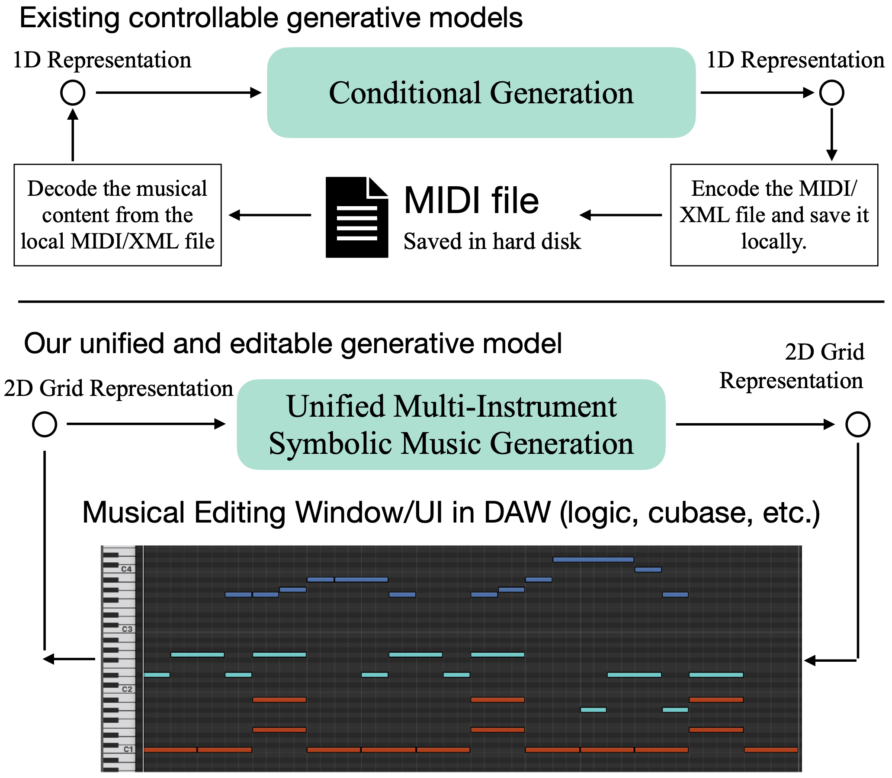
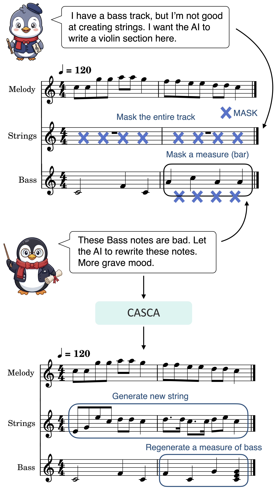

<h2 align="center">CASCA: Learning Cross-Axis Dependency and Sparsity Calibration with Discrete Diffusion for Unified Symbolic Music Generation</h2>

<strong>An end-to-end unified base model for intelligent creation platforms.</strong>

---
## Introduction
CASCA is a unified base model for intelligent creation platforms. It generates multi-instrument accompaniment or target instrument tracks conditioned on input tracks and prompts.
Its data representation is compatible with intelligent creation platforms and digital audio workstations (DAWs) for human–AI collaborative creation scenarios.

The main features are as follows:  

- **End-to-end inference**: Performs end-to-end generation of multi-instrument accompaniment. No prior knowledge of input tracks, expert systems, or manual domain expertise is required.
- **Prompt-conditioned multi-instrument accompaniment**: Supports generating multi-instrument accompaniment, where each instrument can be controlled by its dedicated prompt.
- **Editable generation & Human–AI collaborative creation**: Users specify target instruments and score regions to enable editable generation. Human-authored score segments guide generation and remain preserved.
- **Native integration with intelligent creation platforms**: The data representation works with score editors of intelligent creation platforms and digital audio workstations (DAWs), with no need to encode local MIDI files.
- **Dataset-aligned calibration of music event distribution**: The ratio of PAD tokens to musical events is calibrated against the training dataset.

As shown above, CASCA supports editable generation and serves as a base model for intelligent creation platforms. For instance, users may prepare a lead melody (visualized as dark-blue segments).
If users are unable to compose bass and drum parts, CASCA automatically generates these tracks on demand.
Generated data can be delivered via APIs directly to editors of DAWs or agents. Local digital score files or disk-stored intermediate artifacts (e.g., MIDI, XML, ABC) are not required.

Leveraging these capabilities, CASCA can be deployed for assisted music creation and art education use cases. The schematic diagram is shown below:

---

